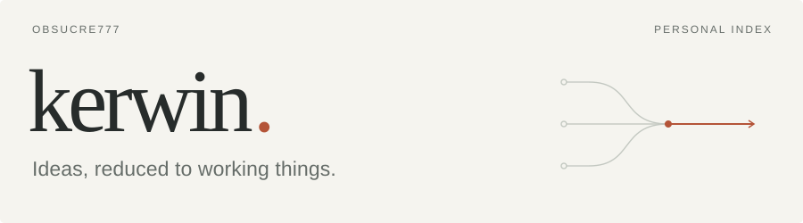

<picture>
  <source media="(prefers-color-scheme: dark)" srcset="assets/index-dark.svg">
  
</picture>

 

做一些让注意力更集中、让 Agent 更自由的工具。

## Selected work

### [Workbar ↗](https://github.com/Obsucre777/WorkBar)

永远置顶的任务条，把注意力收回到现在该做的事。内置 MCP，让 AI 直接参与日常计划。

Rust · Tauri · MCP

### [FreedomAgents ↗](https://github.com/Obsucre777/FreedomAgents)

从 CLI 出发，探索跨 harness 的多 Agent 协作。

JavaScript · Node.js · CLI &nbsp; / &nbsp; v0.0.1 · 开发中

 

[浏览全部仓库 →](https://github.com/Obsucre777?tab=repositories)

---

Boil things down to the most fundamental truths and reason up from there.
