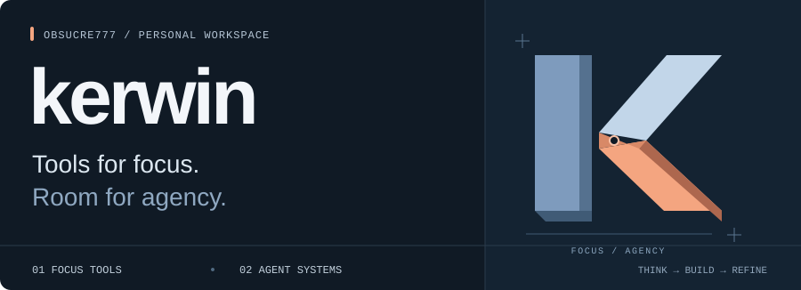
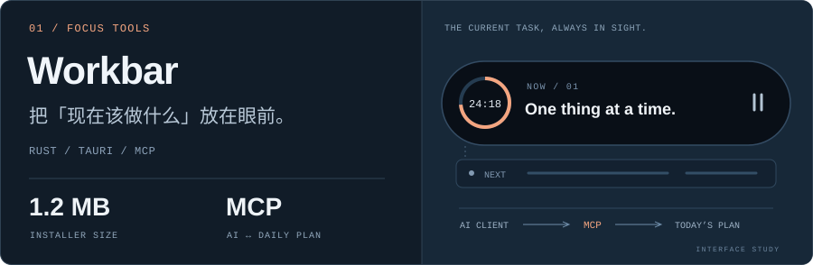
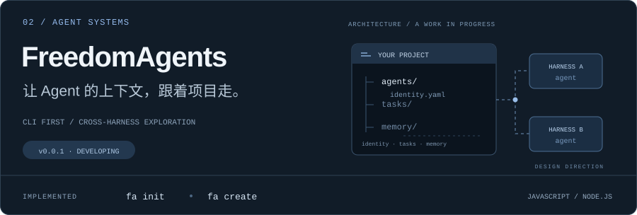
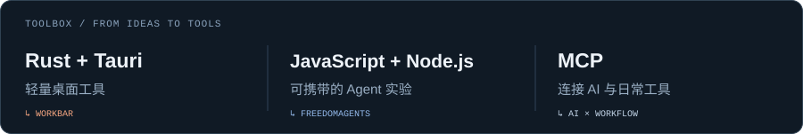

  

### 专注的工具，自主的 Agent。

我在做轻量的 AI 工具，也在探索跨运行环境的 Agent 协作。  
从眼前的问题出发，把想法做成能用的东西。

[项目作品](#selected-projects) &nbsp; / &nbsp; [技术索引](#toolbox) &nbsp; / &nbsp; [全部仓库 ↗](https://github.com/Obsucre777?tab=repositories)

## Selected projects

**[Workbar ↗](https://github.com/Obsucre777/WorkBar)** · 只回答一个问题：**现在该干什么。**  
当前任务、计时与接下来两三项，放在始终可见的悬浮条里。通过 MCP，让支持它的 AI 客户端直接安排计划。

 

**[FreedomAgents ↗](https://github.com/Obsucre777/FreedomAgents)** · 让 Agent 的身份与上下文可以被带走。  
目标是把身份、任务与记忆留在项目里，探索跨 harness 的协作。**目前开发中**，已实现项目初始化和 Agent 创建。

## Toolbox

技术与项目对应

- **Rust + Tauri** → Workbar 的轻量桌面端。
- **JavaScript + Node.js** → FreedomAgents 的 CLI 实验。
- **MCP** → 连接 AI 客户端与日常计划。

 

> Boil things down to the most fundamental truths and reason up from there.

kerwin · [Obsucre777](https://github.com/Obsucre777)
