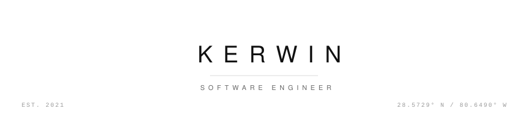

  <picture>
    <source media="(prefers-color-scheme: dark)" srcset="assets/banner-dark.svg">
    
  </picture>

---

## ▚ TELEMETRY

| | |
|:---|:---|
| **STATUS** | 🟢 `NOMINAL` — all systems go |
| **OPERATOR** | kerwin |
| **ROLE** | Software Engineer |
| **BASE** | Earth · Solar System · Orion Arm |
| **FOCUS** | AI Agents / Rust / Audio ML |
| **LAUNCHES** | 12 public payloads since 2021 |

## ▚ LAUNCH VEHICLE

## ▚ FLIGHT DATA

 

## ▚ TRAJECTORY

<picture>
  <source media="(prefers-color-scheme: dark)" srcset="https://raw.githubusercontent.com/Obsucre777/Obsucre777/output/github-snake-dark.svg" />
  <source media="(prefers-color-scheme: light)" srcset="https://raw.githubusercontent.com/Obsucre777/Obsucre777/output/github-snake.svg" />
  
</picture>

---

*"The future is vastly more exciting if we're a spacefaring civilization."*

**— Elon Musk**

 

