  <picture>
    <source media="(prefers-color-scheme: dark)" srcset="assets/hero-dark.svg">
    
  </picture>

building agents & audio systems — all systems nominal.

`Rust` · `Python` · `Java` · `TypeScript` · `C`

---

## Selected Work

[**WorkBar**](https://github.com/Obsucre777/WorkBar)\
a 1.2 MB always-on-top bar that answers one question: *what now?*
`RUST · TAURI · MCP`

[**FreedomAgents**](https://github.com/Obsucre777/FreedomAgents)\
a cross-harness multi-agent framework — agents belong to you, not the harness
`CLI · MULTI-AGENT · OPEN SOURCE`

[**Simul-Whisper**](https://github.com/Obsucre777/simul_whisper)\
attention-guided streaming speech recognition with truncation detection
`INTERSPEECH 2024 · PYTORCH`

---

<pre>
BASE ....... EARTH · SOLAR SYSTEM
FOCUS ...... AGENTS · AUDIO ML
FLIGHTS .... 13 PUBLIC PAYLOADS · EST. 2021
</pre>

28.5729° N / 80.6490° W

